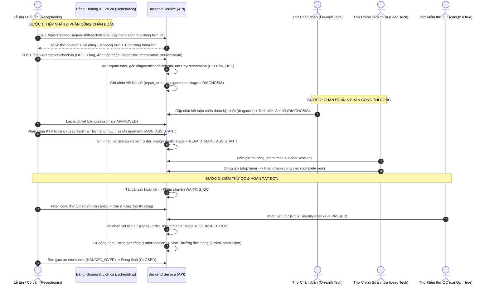

# PLAN: Quy trình Tiếp nhận - Điều phối Trực ca - Phân công 3 Công đoạn (Chẩn đoán, Sửa chữa, Kiểm thử) & Lưu vết Lịch sử Phương tiện - Thợ phục vụ Tính lương

> **Chế độ**: `PLAN:` (Tuân thủ nghiêm ngặt `AutoGarage/AGENTS.md`, `AutoGarage/docs/CODING_GUIDELINES.md`, và `AutoGarage/docs/UI_DESIGN_GUIDELINES.md`).
> **Mục tiêu**: Xây dựng luồng điều phối khép kín từ khi tiếp nhận xe: tự động hiển thị kỹ thuật viên đang trực ca tại thời điểm hiện tại, phân công nhân viên chịu trách nhiệm cho 3 công đoạn bắt buộc (**Chẩn đoán**, **Sửa chữa**, **Kiểm thử QC**), tích hợp bảng điều phối trực quan trên màn **Khoang & Lịch ca**, và lưu vết toàn bộ lịch sử thi công xe - thợ - ca trực để tính lương công bằng, theo dõi KPI và truy vết khi có khiếu nại bảo hành.

---

## 1. Mục tiêu & Phạm vi

### 1.1. Yêu cầu nghiệp vụ
1. **Tiếp nhận 1 xe vào xưởng (`Check-in`)**:
   - Phân công rõ ràng nhân sự chịu trách nhiệm cho **3 công đoạn cốt lõi**:
     - **Công đoạn 1: Chẩn đoán (`DIAGNOSIS`)**: Nhân viên kỹ thuật/cố vấn tiếp nhận xe, quét mã lỗi OBD-II, ghi nhận hiện trạng ban đầu và kết luận nguyên nhân hư hỏng.
     - **Công đoạn 2: Sửa chữa (`REPAIR`)**: Kỹ thuật viên trưởng (Lead Tech) và các thợ phụ trách từng hạng mục thay thế phụ tùng, phục hồi chi tiết.
     - **Công đoạn 3: Kiểm thử chất lượng (`QC / TESTING`)**: Kỹ thuật viên kiểm thử độc lập (có chứng chỉ `canQc = true`), thực hiện nghiệm thu theo checklist (chạy thử đường trường, kiểm tra lực phanh, độ rò rỉ, xóa mã lỗi).
2. **Hiển thị ca trực thời gian thực (Live On-Shift Roster)**:
   - Khi tiếp nhận hoặc điều phối trên màn **Khoang & Lịch ca (`/scheduling`)**:
     - Tự động lọc và hiển thị danh sách kỹ thuật viên **đang trong ca trực tại thời điểm hiện tại** (`startsAt <= now <= endsAt` và `status == ACTIVE`).
     - Hiển thị trực quan: Khoang đang trực (`ServiceBay`), Chuyên môn kỹ thuật (`skills`: Máy, Gầm, Điện, Lạnh, Sơn, QC), và Tải công việc hiện tại (Số xe đang phụ trách, Trạng thái Timer thi công).
3. **Lưu vết lịch sử "Phương tiện - Ca trực - Kỹ thuật viên" (Vehicle-Technician-Shift Audit Trail)**:
   - Lưu trữ bản ghi vĩnh viễn: Xe nào (Biển số, VIN), do ai chẩn đoán, ai sửa chữa hạng mục nào, ai kiểm thử QC, vào ca trực ngày nào, thời lượng thực tế bao nhiêu phút.
   - **Mục đích**:
     - **Tính lương & Thưởng năng suất**: Giờ công thực tế theo ca (`hourlyCost * actualHours`), hoa hồng theo đơn hoàn thành đạt QC.
     - **Theo dõi KPI & Quá trình làm việc của thợ**: Đánh giá tay nghề, số xe đã xử lý, tỷ lệ xe đạt nghiệm thu ngay lần đầu (First-time Pass Rate).
     - **Truy xuất nguồn gốc bảo hành**: Khi xe quay lại bảo hành, lập tức tra cứu được đội ngũ đã thao tác trên xe để quy trách nhiệm và phân tích nguyên nhân kỹ thuật.

---

## 2. Phân tích Vấn đề Hiện tại & Phương án Cải thiện Phù hợp (Gap Analysis & Solution Architecture)

### 2.1. Bảng đối chiếu hiện trạng và giải pháp

| Điểm nghẽn hiện tại | Hậu quả thực tế | Phương án cải thiện chuẩn hóa |
| :--- | :--- | :--- |
| **1. Tiếp nhận xe (`CheckInModal.tsx`) chưa gắn nhân sự và khoang** | Tiếp nhận chỉ ghi nhận ODO/xăng; không biết ai sẽ chẩn đoán xe, xe đỗ ở đâu trong xưởng. | Bổ sung trường chọn **Kỹ thuật viên chẩn đoán (`diagnosticTechnicianId`)** và **Khoang tiếp nhận (`serviceBayId`)** ngay khi Check-in. Gợi ý danh sách thợ đang trực ca hiện tại. |
| **2. Màn Khoang & Lịch ca (`/scheduling`) chia 3 tab rời rạc** | Quản đốc không quan sát được: "Khoang 1 đang có xe nào? Thợ nào đang trực ở khoang đó? Ai đang rảnh để nhận xe mới?". | Xây dựng **Bảng điều phối trực ca & khoang xưởng thời gian thực (Live Bay & Shift Dispatch Board)** kết nối 3 thực thể: `[Khoang dịch vụ] <---> [Xe đang đỗ] <---> [Thợ đang trực ca]`. |
| **3. Kiểm định QC chưa áp dụng nguyên tắc Độc lập (Four-Eyes Principle)** | Bất kỳ ai có quyền Technical cũng bấm được QC; thợ vừa thi công có thể tự nghiệm thu cho chính mình. | Ràng buộc nghiệp vụ: Thợ QC bắt buộc phải có cờ `canQc = true`, đang trong ca trực hoạt động, và **không được trùng với thợ chính vừa thi công hạng mục đó**. |
| **4. Thiếu bảng lưu vết lịch sử tập trung giữa Xe và Thợ** | Dữ liệu nằm phân tán ở `LaborSession`, `TaskAssignment`, `RepairTask`, `QualityCheck`. Khi tra cứu lịch sử xe rất chậm và khó tính thưởng. | Thiết kế bảng lưu vết tập trung **`repair_order_assignments`** (hoặc view tổng hợp `v_vehicle_technician_history`), liên kết: `vehicle_id`, `repair_order_id`, `employee_id`, `shift_id`, `stage` (`DIAGNOSIS`, `REPAIR_MAIN`, `REPAIR_ASSISTANT`, `QC_INSPECTION`). |

---

### 2.2. Sơ đồ Luồng Nghiệp vụ Khép kín (End-to-End Workflow)



---

## 3. Thiết kế Cơ sở dữ liệu & Entity (Database Schema Migration)

Tạo file migration [`V13__create_vehicle_work_logs_and_shift_dispatch.sql`](file:///c:/Users/mrdoanh/IdeaProjects/AutoGarage/AutoGarage/src/main/resources/db/migration/V13__create_vehicle_work_logs_and_shift_dispatch.sql):

### 3.1. Bổ sung trường vào bảng hiện có
1. **Bảng `repair_orders`**:
   - `diagnostic_technician_id`: `BIGINT NULL` (Kỹ thuật viên phụ trách tiếp nhận & chẩn đoán ban đầu, FK `employees(id)`).
   - `service_bay_id`: `BIGINT NULL` (Khoang dịch vụ xe đang đỗ thực tế, FK `service_bays(id)`).
   - `qc_technician_id`: `BIGINT NULL` (Kỹ thuật viên nghiệm thu chất lượng cuối cùng, FK `employees(id)`).
2. **Bảng `employee_shifts`**:
   - `service_bay_id`: `BIGINT NULL` (Khoang kỹ thuật viên phụ trách trực trong ca, FK `service_bays(id)`).
   - `shift_type`: `VARCHAR(20) NOT NULL DEFAULT 'STANDARD'` (`MORNING`, `AFTERNOON`, `OVERTIME`, `FULL_DAY`).

### 3.2. Tạo bảng lưu vết Lịch sử Thi công Phương tiện - Thợ - Ca trực
**Bảng `repair_order_assignments`** (Bảng trung tâm theo dõi thợ nào đã làm xe nào, thuộc ca nào, công đoạn gì):
```sql
CREATE TABLE repair_order_assignments (
    id BIGINT AUTO_INCREMENT PRIMARY KEY,
    repair_order_id BIGINT NOT NULL,
    vehicle_id BIGINT NOT NULL,
    employee_id BIGINT NOT NULL,
    shift_id BIGINT NULL,
    assignment_stage VARCHAR(30) NOT NULL, -- 'DIAGNOSIS', 'REPAIR_MAIN', 'REPAIR_ASSISTANT', 'QC_INSPECTION'
    task_id BIGINT NULL,                   -- Khóa ngoại trỏ đến repair_tasks nếu là công đoạn sửa chữa chi tiết
    started_at DATETIME(6) NOT NULL,
    completed_at DATETIME(6) NULL,
    actual_seconds BIGINT NOT NULL DEFAULT 0,
    hourly_rate_snapshot DECIMAL(18,2) NOT NULL DEFAULT 0.00,
    earned_commission DECIMAL(18,2) NOT NULL DEFAULT 0.00,
    result_status VARCHAR(20) NOT NULL DEFAULT 'IN_PROGRESS', -- 'IN_PROGRESS', 'PASSED', 'REWORK_FAILED', 'COMPLETED'
    notes TEXT NULL,
    created_at DATETIME(6) NOT NULL,
    updated_at DATETIME(6) NOT NULL,
    version BIGINT NOT NULL DEFAULT 0,
    CONSTRAINT fk_roa_order FOREIGN KEY (repair_order_id) REFERENCES repair_orders(id),
    CONSTRAINT fk_roa_vehicle FOREIGN KEY (vehicle_id) REFERENCES vehicles(id),
    CONSTRAINT fk_roa_employee FOREIGN KEY (employee_id) REFERENCES employees(id),
    CONSTRAINT fk_roa_shift FOREIGN KEY (shift_id) REFERENCES employee_shifts(id),
    CONSTRAINT fk_roa_task FOREIGN KEY (task_id) REFERENCES repair_tasks(id)
) ENGINE=InnoDB DEFAULT CHARSET=utf8mb4 COLLATE=utf8mb4_unicode_ci;

CREATE INDEX idx_roa_vehicle ON repair_order_assignments(vehicle_id);
CREATE INDEX idx_roa_employee ON repair_order_assignments(employee_id);
CREATE INDEX idx_roa_order ON repair_order_assignments(repair_order_id);
CREATE INDEX idx_roa_shift ON repair_order_assignments(shift_id);
CREATE INDEX idx_roa_stage ON repair_order_assignments(assignment_stage);
```

---

## 4. Danh sách file mục tiêu

### 4.1. Backend Java Files

| STT | File mục tiêu | Vùng dòng / Loại | Nội dung thêm / sửa chi tiết |
| :--- | :--- | :--- | :--- |
| **1** | `src/main/resources/db/migration/V13__create_vehicle_work_logs_and_shift_dispatch.sql` | Toàn bộ file mới | Tạo bảng `repair_order_assignments`, thêm các cột `diagnostic_technician_id`, `service_bay_id`, `qc_technician_id` vào `repair_orders`, và `service_bay_id`, `shift_type` vào `employee_shifts`. |
| **2** | [`CheckInVehicleRequest.java`](file:///c:/Users/mrdoanh/IdeaProjects/AutoGarage/AutoGarage/src/main/java/com/Group13_65CNTT/AutoGarage/reception/dto/CheckInVehicleRequest.java) & `CheckInVehicleResponse.java` | Lines 25–45 | Bổ sung các trường `diagnosticTechnicianId` và `serviceBayId` khi tiếp nhận xe. |
| **3** | [`ReceptionServiceImpl.java`](file:///c:/Users/mrdoanh/IdeaProjects/AutoGarage/AutoGarage/src/main/java/com/Group13_65CNTT/AutoGarage/reception/service/ReceptionServiceImpl.java) | Lines 120–155 | Khi tiếp nhận xe thành công: Lưu `diagnosticTechnicianId`, giữ khoang `serviceBayId` (tạo `BayReservation`), và tự động ghi một bản ghi vào `repair_order_assignments` với stage `DIAGNOSIS`. |
| **4** | [`RepairOrder.java`](file:///c:/Users/mrdoanh/IdeaProjects/AutoGarage/AutoGarage/src/main/java/com/Group13_65CNTT/AutoGarage/repair/entity/RepairOrder.java) & `RepairOrderResponse.java` | Lines 55–75 | Bổ sung `diagnosticTechnicianId`, `serviceBayId`, `qcTechnicianId`, `leadTechnicianId` vào Entity, DTO, và Response. |
| **5** | `src/main/java/com/Group13_65CNTT/AutoGarage/scheduling/controller/SchedulingController.java` & `SchedulingService.java` | File mới / mở rộng | Thêm endpoint `GET /api/v1/scheduling/on-shift-technicians`: Lấy danh sách kỹ thuật viên đang trong ca trực hoạt động tại thời điểm `now`, kèm khoang trực, kỹ năng chuyên môn, và tải việc hiện tại. |
| **6** | `src/main/java/com/Group13_65CNTT/AutoGarage/repair/entity/RepairOrderAssignment.java` & `RepairOrderAssignmentRepository.java` | File mới | Entity và Repository quản lý vết lịch sử làm việc của nhân viên theo phương tiện, ca trực và công đoạn. |
| **7** | [`LaborExecutionServiceImpl.java`](file:///c:/Users/mrdoanh/IdeaProjects/AutoGarage/AutoGarage/src/main/java/com/Group13_65CNTT/AutoGarage/repair/service/impl/LaborExecutionServiceImpl.java) | Lines 220–320 | - Khi phân công task: Tự động ghi vết `REPAIR_MAIN` / `REPAIR_ASSISTANT` vào `repair_order_assignments`, tự động map với ca trực hiện tại của thợ (`shiftId`).<br>- Khi hoàn thành task: Cập nhật `actualSeconds`, `hourlyRateSnapshot`. |
| **8** | [`QualityServiceImpl.java`](file:///c:/Users/mrdoanh/IdeaProjects/AutoGarage/AutoGarage/src/main/java/com/Group13_65CNTT/AutoGarage/quality/service/impl/QualityServiceImpl.java) | Lines 50–90 | Ràng buộc người thực hiện QC: Kiểm tra `canQc = true`, đang trong ca trực hoạt động, và không trùng với thợ chính đã sửa task đó. Ghi nhận vết `QC_INSPECTION` vào `repair_order_assignments`. |
| **9** | `src/main/java/com/Group13_65CNTT/AutoGarage/vehicle/controller/VehicleController.java` & `VehicleService.java` | Lines 120–150 | Thêm endpoint `GET /api/v1/vehicles/{id}/work-history`: Trả về toàn bộ lịch sử các kỹ thuật viên đã từng chẩn đoán, sửa chữa, kiểm thử trên phương tiện đó (phục vụ khách hàng và cố vấn tra cứu bảo hành). |

---

### 4.2. Frontend TypeScript & React Files

| STT | File mục tiêu | Vùng dòng / Loại | Nội dung thêm / sửa chi tiết |
| :--- | :--- | :--- | :--- |
| **1** | `frontend/src/features/scheduling/api/schedulingApi.ts` & `useScheduling.ts` | Lines 20–50 | Bổ sung hook `useOnShiftTechniciansQuery()` gọi endpoint `GET /api/v1/scheduling/on-shift-technicians`. |
| **2** | [`CheckInModal.tsx`](file:///c:/Users/mrdoanh/IdeaProjects/AutoGarage/AutoGarage/frontend/src/features/reception/components/CheckInModal.tsx) | Toàn bộ file | Bổ sung 2 trường chọn thông minh:<br>1. **Kỹ thuật viên chẩn đoán tiếp nhận**: Dropdown hiển thị các thợ đang trực ca hiện tại (kèm badge kỹ năng và trạng thái rảnh).<br>2. **Khoang tiếp nhận**: Chọn khoang đang trống để xe vào kiểm tra ban đầu. |
| **3** | `frontend/src/features/scheduling/components/LiveDispatchBoard.tsx` | Component mới | **Bảng điều phối trực ca & khoang xưởng thời gian thực**: Lưới hiển thị các khoang dịch vụ, trạng thái xe đang ở khoang, thợ trực ca phụ trách, tiến độ sửa xe, và nút phân công nhanh thợ đang rảnh vào xe mới. |
| **4** | [`SchedulingPage.tsx`](file:///c:/Users/mrdoanh/IdeaProjects/AutoGarage/AutoGarage/frontend/src/features/scheduling/pages/SchedulingPage.tsx) | Lines 50–120 | Thêm chế độ xem Tab **"Điều phối xưởng thời gian thực" (Live Dispatch)** tích hợp `LiveDispatchBoard` làm màn hình chính cho Quản đốc / Cố vấn dịch vụ. |
| **5** | [`RepairOrderDetailModal.tsx`](file:///c:/Users/mrdoanh/IdeaProjects/AutoGarage/AutoGarage/frontend/src/features/repair/components/RepairOrderDetailModal.tsx) | Lines 380–470 | - Tab "Chẩn đoán": Hiển thị tên Thợ chẩn đoán tiếp nhận.<br>- Tab "Công việc": Bổ sung chọn Thợ chính (Lead Tech), chọn thợ đang on-shift cho từng task.<br>- Tab "QC": Gợi ý thợ kiểm định đủ điều kiện (`canQc = true`, đang on-shift, không phải thợ thi công). |
| **6** | `frontend/src/features/vehicle/components/VehicleWorkHistoryTab.tsx` | Component mới | Tab **"Lịch sử thi công & Nhân sự"** trong chi tiết phương tiện: Hiển thị dòng thời gian rõ ràng: ngày nào, ca trực nào, thợ nào đã chẩn đoán, thợ nào đã sửa chữa hạng mục gì, ai đã nghiệm thu QC, tổng thời gian và kết quả. |
| **7** | `frontend/src/features/payroll/components/EmployeeWorkSummaryModal.tsx` | Component mới | Bảng tổng hợp công việc của Kỹ thuật viên: Xem danh sách toàn bộ các xe và ca sửa chữa thợ đã thực hiện trong tháng, tổng giờ thi công thực tế, số lệnh hoàn thành đạt QC để đối soát tính lương minh bạch. |

---

## 5. Hợp đồng kỹ thuật (Contract)

### 5.1. DTO & API Contract

#### 1. API Danh sách Kỹ thuật viên đang trong Ca trực (`GET /api/v1/scheduling/on-shift-technicians`)
- **Quyền**: `@PreAuthorize(SecurityConstants.HAS_ROLE_STAFF)` (`ADMIN`, `RECEPTIONIST`, `TECHNICIAN`, `WAREHOUSE_STAFF`).
- **Response**: `ApiResponse<List<OnShiftTechnicianResponse>>`
  ```json
  [
    {
      "employeeId": 6,
      "employeeCode": "KT-MINH",
      "fullName": "Nguyễn Văn Minh",
      "shiftId": 14,
      "shiftType": "MORNING",
      "shiftStartsAt": "2026-11-01T07:30:00Z",
      "shiftEndsAt": "2026-11-01T11:30:00Z",
      "serviceBayId": 2,
      "bayCode": "BAY-02",
      "bayName": "Khoang Cầu nâng 2 trụ B",
      "skills": ["ENGINE", "BRAKE", "UNDERCARRIAGE"],
      "canQc": true,
      "activeOrdersCount": 1,
      "hasActiveTimer": true,
      "activeTaskId": 25,
      "availabilityStatus": "BUSY" // "AVAILABLE" (đang rảnh) | "BUSY" (đang chạy timer) | "OVERLOADED"
    }
  ]
  ```

#### 2. Cập nhật Request Tiếp nhận xe (`POST /api/v1/reception/check-in`)
- Thêm các trường:
  - `diagnosticTechnicianId`: `Long` (Tùy chọn — ID nhân viên kỹ thuật chẩn đoán ban đầu).
  - `serviceBayId`: `Long` (Tùy chọn — ID khoang tiếp nhận xe).

#### 3. API Lịch sử Thi công Phương tiện (`GET /api/v1/vehicles/{id}/work-history`)
- **Response**: `ApiResponse<List<VehicleWorkHistoryResponse>>`
  ```json
  [
    {
      "id": 101,
      "repairOrderId": 5,
      "orderCode": "RO-20261101-002",
      "licensePlate": "30A-123.45",
      "stage": "DIAGNOSIS",
      "taskName": "Chẩn đoán hiện trạng tiếp nhận & quét lỗi OBD-II",
      "employeeId": 6,
      "employeeName": "Nguyễn Văn Minh",
      "shiftType": "MORNING",
      "startedAt": "2026-11-01T08:00:00Z",
      "completedAt": "2026-11-01T08:35:00Z",
      "actualMinutes": 35,
      "resultStatus": "COMPLETED",
      "notes": "Phát hiện mã lỗi P0301 - Bỏ lửa xi lanh 1, bu-gi mòn điện cực"
    },
    {
      "id": 102,
      "repairOrderId": 5,
      "orderCode": "RO-20261101-002",
      "licensePlate": "30A-123.45",
      "stage": "REPAIR_MAIN",
      "taskName": "Thay thế bộ 4 bu-gi Iridium & Vệ sinh họng hút",
      "employeeId": 7,
      "employeeName": "Trần Văn Đức",
      "shiftType": "MORNING",
      "startedAt": "2026-11-01T09:00:00Z",
      "completedAt": "2026-11-01T10:15:00Z",
      "actualMinutes": 75,
      "resultStatus": "COMPLETED",
      "notes": "Đã thay thế và siết lực 25Nm theo tiêu chuẩn hãng"
    },
    {
      "id": 103,
      "repairOrderId": 5,
      "orderCode": "RO-20261101-002",
      "licensePlate": "30A-123.45",
      "stage": "QC_INSPECTION",
      "taskName": "Kiểm tra chất lượng hoàn tất & Chạy thử động cơ",
      "employeeId": 6,
      "employeeName": "Nguyễn Văn Minh",
      "shiftType": "MORNING",
      "startedAt": "2026-11-01T10:30:00Z",
      "completedAt": "2026-11-01T10:50:00Z",
      "actualMinutes": 20,
      "resultStatus": "PASSED",
      "notes": "Động cơ nổ êm, vòng tua ổn định 750 RPM, không còn mã lỗi"
    }
  ]
  ```

---

### 5.2. Quy tắc Nghiệp vụ Ràng buộc (Business Invariants)

1. **Ràng buộc Phân công Chẩn đoán**:
   - Khi tiếp nhận xe, nếu chọn `diagnosticTechnicianId`, nhân viên đó bắt buộc phải có ca trực đang hoạt động tại thời điểm hiện tại (`shift.startsAt <= now <= shift.endsAt`).
2. **Ràng buộc Kiểm định Chất lượng QC (Four-Eyes Principle)**:
   - Thợ thực hiện QC bắt buộc phải có `canQc = true`.
   - **Tuyệt đối không cho phép Thợ chính (`REPAIR_MAIN`) tự làm QC cho chính hạng mục hoặc đơn hàng mà mình là người thi công chính**. Phải do một kỹ thuật viên khác kiểm tra độc lập để đảm bảo chất lượng khách quan.
3. **Tính lương & Thưởng từ Vết Lịch sử (`repair_order_assignments`)**:
   - Lương giờ công được tính chính xác từ `actual_seconds * hourly_rate_snapshot`.
   - Lương thưởng đơn (`earned_commission`) chỉ được kết chuyển sang bảng lương khi công đoạn hoặc phiếu sửa chữa có trạng thái `PASSED` / `COMPLETED`.
   - Nếu phát sinh bảo hành lỗi làm lại (`REWORK_FAILED`), công đoạn đó không được tính thưởng năng suất và bị đánh dấu giảm trừ KPI.

---

### 5.3. Thiết kế Giao diện (Tuân thủ `UI_DESIGN_GUIDELINES.md`)

1. **Trong `CheckInModal.tsx`**:
   - Form modal đặt chính giữa màn hình (`placement="center"`), chia lưới 2 cột cân đối trên desktop.
   - Nhóm thông tin điều phối ban đầu:
     - **Cột trái**: Biển số, ODO, Xăng, Yêu cầu khách, Ảnh tiếp nhận.
     - **Cột phải**: Ô chọn **Kỹ thuật viên chẩn đoán** (dropdown hiện rõ thợ đang trực ca, badge kỹ năng xanh lá, trạng thái rảnh/bận) + Ô chọn **Khoang tiếp nhận** (hiển thị khoang sẵn sàng nhận xe).
2. **Bảng Điều phối Trực ca & Khoang Xưởng (`LiveDispatchBoard.tsx`)**:
   - Được tích hợp trực tiếp vào màn `/scheduling`.
   - Hiển thị danh sách card khoang dịch vụ trực quan:
     - Header card: Mã khoang, Loại khoang, Badge trạng thái (`TRỐNG` / `ĐANG SỬA` / `CHỜ QC`).
     - Body card: Xe đang ở khoang (Biển số to rõ, Mã lệnh sửa chữa, Tiến độ giờ làm), Thợ chính đang thao tác (Avatar, Tên thợ, Timer đang đếm giây).
     - Footer card: Nút hành động nhanh: **"Chỉ định thợ trực"**, **"Chuyển khoang"**, **"Xem tiến độ"**.
3. **Tab Lịch sử Thi công trong Hồ sơ Phương tiện (`VehicleWorkHistoryTab.tsx`)**:
   - Trình bày dạng Timeline dọc tinh gọn, tối giản:
     - Mỗi nút mốc thời gian đại diện cho một công đoạn: Chẩn đoán (Icon Kính lúp cam), Sửa chữa (Icon Cờ-lê xanh dương), Kiểm thử (Icon Khiên xanh lá).
     - Hiển thị rõ: Tên thợ, Ca trực, Thời lượng thi công, Ghi chú kỹ thuật, Kết quả nghiệm thu.

---

## 6. Checklist thực thi

- [x] **Step 1 (Database Migration & Entities)**:
  - Tạo file migration `V13__create_vehicle_work_logs_and_shift_dispatch.sql`.
  - Cập nhật các Entity `RepairOrder`, `EmployeeShift`.
  - Tạo Entity `RepairOrderAssignment` và `RepairOrderAssignmentRepository`.
- [x] **Step 2 (Backend — API Kỹ thuật viên Trực ca & Điều phối Tiếp nhận)**:
  - Cài đặt service và endpoint `GET /api/v1/scheduling/on-shift-technicians` trong `SchedulingController.java`.
  - Cập nhật `CheckInVehicleRequest`, `ReceptionServiceImpl` để gán thợ chẩn đoán, giữ khoang tiếp nhận và lưu vết `DIAGNOSIS`.
- [x] **Step 3 (Backend — Lưu vết Thi công & Ràng buộc Độc lập QC)**:
  - Cập nhật `LaborExecutionServiceImpl`: Tự động ghi nhận `REPAIR_MAIN`/`REPAIR_ASSISTANT` vào `repair_order_assignments` khi bấm giờ và hoàn thành task.
  - Cập nhật `QualityServiceImpl`: Bắt buộc thợ QC có `canQc = true`, đang trong ca trực, không trùng thợ thi công chính, và ghi vết `QC_INSPECTION`.
  - Cài đặt endpoint `GET /api/v1/vehicles/{id}/work-history` trong `VehicleController.java`.
- [x] **Step 4 (Frontend — Tích hợp Phân công Thợ & Khoang khi Tiếp nhận xe)**:
  - Cập nhật `receptionApi.ts`, `schemas.ts`, `contracts.ts`.
  - Nâng cấp `CheckInModal.tsx`: Thêm dropdown chọn Thợ chẩn đoán đang on-shift và chọn Khoang tiếp nhận.
- [x] **Step 5 (Frontend — Xây dựng Bảng Điều phối Trực ca & Khoang Xưởng thời gian thực)**:
  - Tạo component `LiveDispatchBoard.tsx`.
  - Nâng cấp `SchedulingPage.tsx` tích hợp Tab điều phối xưởng trực quan kết nối Khoang - Xe - Ca - Thợ.
- [x] **Step 6 (Frontend — Tab Lịch sử Thi công trên Hồ sơ Xe & Báo cáo KPI Thợ)**:
  - Tạo component `VehicleWorkHistoryTab.tsx` tích hợp vào màn chi tiết phương tiện `/vehicles`.
  - Tạo component `EmployeeWorkSummaryModal.tsx` để xem lịch sử ca/xe thợ đã làm phục vụ đối soát bảng lương.
- [x] **Step 7 (Kiểm thử, Xác minh & Bàn giao)**:
  - Chạy migration trên MySQL Docker.
  - Chạy kịch bản kiểm thử luồng khép kín: Check-in phân công chẩn đoán $\rightarrow$ Sửa chữa bấm giờ $\rightarrow$ Nghiệm thu QC độc lập $\rightarrow$ Truy xuất lịch sử xe và tổng hợp công nợ/lương.
  - Kiểm tra `mvn test` và `tsc --noEmit`.