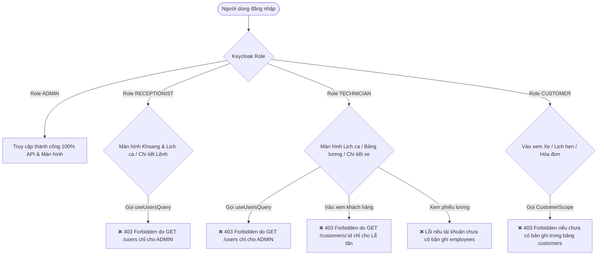

# PLAN: Kiểm Tra Tổng Thể & Chi Tiết Toàn Bộ Hệ Thống AutoGarage — Báo Cáo Thiếu Sót, Lỗ Hổng & Kế Hoạch Cải Thiện Toàn Dự Án

> **Chế độ**: `PLAN:` (Tuân thủ nghiêm ngặt `AutoGarage/AGENTS.md`, `AutoGarage/docs/CODING_GUIDELINES.md`, và `AutoGarage/docs/UI_DESIGN_GUIDELINES.md`).
> **Mục tiêu**: Thực hiện rà soát chuyên sâu (Comprehensive System Audit) từ kiến trúc tổng thể đến chi tiết từng dòng code và luồng nghiệp vụ trên toàn bộ dự án AutoGarage:
> 1. **Vạch rõ toàn bộ các thiếu sót, lỗ hổng, những điểm chưa đúng chuẩn thực tế** trong 11 luồng nghiệp vụ cốt lõi của xưởng gara.
> 2. **Giải quyết triệt để lỗi "Màn hình chạy ổn ở Admin nhưng chuyển sang tài khoản khác lại không load được dữ liệu"** (Role mismatch, 403 Forbidden, gãy liên kết thực thể, truy vấn sai quyền).
> 3. **Xây dựng lộ trình cải thiện chuẩn hóa toàn dự án**: Kiến trúc Backend, Bảo mật & Phân quyền, Toàn vẹn Dữ liệu Tài chính - Kho - Lương, và Tối ưu hóa Trải nghiệm Giao diện UI/UX.

---

## 1. Tổng Quan Kiến Trúc & Hiện Trạng Dự Án (Architectural Overview)

### 1.1. Bản Đồ Công Nghệ Hiện Tại
- **Backend**: Spring Boot 3.3.4, Java 21 LTS, Spring Security + OAuth2 Resource Server (Keycloak 26 OIDC / JWT), Flyway (V1 $\to$ V17), Spring Data JPA / Hibernate, MySQL 8.4 LTS (Port 3307).
- **Frontend**: React 18, TypeScript, TailwindCSS, Vite, TanStack Query v5, TanStack Table v8, React Router DOM v6, Radix UI Dialogs / Primitives, Lucide Icons.
- **DevOps & Môi trường**: Docker Compose (`mysql:8.4`, `keycloak:26.0`, `autogarage-backend`), Maven Wrapper (`./mvnw.cmd`).
- **Phân hệ nghiệp vụ (15 modules)**: `identity`, `customer`, `vehicle`, `catalog`, `reception`, `estimate`, `repair`, `scheduling`, `quality`, `inventory`, `billing`, `warranty`, `payroll`, `reporting`, `audit`.

---

## 2. Báo Cáo Kiểm Tra Chi Tiết Các Luồng Nghiệp Vụ & Danh Mục Lỗ Hổng (Defect & Gap Analysis)

### 2.1. Phân Tích Lỗ Hổng Lớn Nhất: Lỗi Phân Quyền & Không Load Được Dữ Liệu Khi Đổi Role



#### Chi tiết 4 Điểm Gãy Phân Quyền Cốt Lõi:
1. **Điểm gãy 1 — Phụ thuộc chết người vào `useUsersQuery` (`GET /api/v1/users`)**:
   - `SchedulingPage.tsx`, `ShiftEditor.tsx`, `EmployeeEditor.tsx`, `RepairOrderDetailModal.tsx` đều gọi `useUsersQuery()` để lấy `fullName` của Kỹ thuật viên từ `userId`.
   - Nhưng `GET /api/v1/users` chỉ cho phép `ADMIN` (`@PreAuthorize("hasRole('ADMIN')")`).
   - $\rightarrow$ **Hậu quả**: Bất kỳ ai không phải Admin (`RECEPTIONIST`, `TECHNICIAN`, `CUSTOMER`) mở các màn hình này đều bị mã lỗi **403 Forbidden**, tên thợ hiển thị `—`, hoặc query error làm sập giao diện.
2. **Điểm gãy 2 — Ràng buộc cứng nhắc trong `CustomerScope.java` làm sập tài khoản Khách hàng**:
   - Hàm `currentCustomerId()` ném `BusinessException(ResponseCode.FORBIDDEN)` nếu không tìm thấy bản ghi `Customer` có `user_id == currentUser.userId()`.
   - $\rightarrow$ **Hậu quả**: Khách hàng tạo tài khoản trên Keycloak hoặc đăng ký mới khi đăng nhập vào hệ thống thì **100% màn hình (`/vehicles`, `/reception`, `/repair-orders`, `/billing/invoices`) đều bị chặn 403**, không thể thao tác bất kỳ điều gì!
3. **Điểm gãy 3 — Quyền hạn của Thợ bị khóa quá chặt đối với thông tin liên hệ**:
   - `CustomerController.java` đặt `@PreAuthorize(SecurityConstants.HAS_FRONT_DESK)` cho cả thao tác đọc chi tiết khách hàng.
   - $\rightarrow$ **Hậu quả**: Thợ sửa xe khi đang thi công muốn gọi điện xác nhận lỗi kỹ thuật với chủ xe thì không thể xem được số điện thoại.
4. **Điểm gãy 4 — Thiếu cơ chế Auto-Provisioning cho Thợ kỹ thuật**:
   - Khi tạo user `TECHNICIAN` trên Keycloak, nếu Quản trị viên chưa vào tạo một bản ghi `Employee` tương ứng trong MySQL, thợ đăng nhập vào `/payroll` sẽ bị lỗi sập màn hình phiếu lương cá nhân.

---

### 2.2. Kiểm Tra Tổng Thể 11 Luồng Nghiệp Vụ Cốt Lõi Của Xưởng

#### Luồng 1: Khách hàng & Phương tiện (Customer & Vehicle)
- **Thiếu sót hiện tại**:
  - Biển số xe chưa có chuẩn hóa tự động bỏ dấu gạch ngang/dấu chấm khi tìm kiếm (ví dụ: `30A-123.45` vs `30A12345`).
  - Chưa lưu lịch sử chuyển nhượng chủ sở hữu xe khi bán lại (`vehicle_ownership_history`).
  - Khi xóa phương tiện, chưa kiểm tra ràng buộc xem xe đó có đang nằm trong Lệnh sửa chữa đang mở hay không.

#### Luồng 2: Đặt lịch hẹn & Lễ tân Tiếp nhận xe (Booking & Check-in)
- **Thiếu sót hiện tại**:
  - Form tiếp nhận (`CheckInModal.tsx`) dùng thẻ `<select>` thuần, khó tìm kiếm khi gara có nhiều xe và nhiều thợ.
  - Lúc chọn khoang, form trước đây chỉ tìm thợ được gán trước vào khoang đó, không cho chọn thợ cơ động đang đi làm trong xưởng.
  - Chưa hỗ trợ chụp ảnh tình trạng xe trước khi vào xưởng (vết xước, móp méo) để so khớp chẩn đoán và chống tranh chấp khi bàn giao.

#### Luồng 3: Chẩn đoán & Lập Báo giá (Diagnosis & Estimates)
- **Thiếu sót hiện tại**:
  - Modal chi tiết báo giá (`EstimateDecisionModal.tsx`) thiếu tên Khách hàng và thông tin Xe.
  - Bố cục thông số *Loại báo giá / Gửi khách lúc / Hiệu lực đến* bị xếp dọc tốn diện tích, xuất hiện số `0` thừa do lỗi JSX `{(it.warrantyDays || ...) &&}`.
  - Box duyệt từng dòng quá to, nút bấm cồng kềnh, chữ chưa được dàn ngang cân đối.

#### Luồng 4: Điều phối Khoang & Lịch ca Trực (Service Bay & Shifts)
- **Thiếu sót hiện tại**:
  - Lỗi giao diện trên màn hình `/scheduling` (Ảnh 1): Thẻ Khoang xưởng bị chèn chữ đè mất nửa thân chữ ở đáy card; thẻ Thợ bị cắt cụt dòng chữ thưởng ca do khung quá hẹp.
  - Nếu khi xếp ca bắt buộc phải chọn khoang thì triệt tiêu mất nhóm thợ cơ động và gây tắc nghẽn khi thợ nhiều hơn số cầu nâng.
  - Chưa cho phép nhân viên tự gửi yêu cầu đăng ký ca làm việc mong muốn để Quản đốc duyệt.

#### Luồng 5: Phân công Công việc & Thi công Bấm giờ (Labor Sessions & Timers)
- **Thiếu sót hiện tại**:
  - Chưa có cơ chế **Tự động đóng Timer khi hết ca trực**: Nếu thợ quên bấm "Dừng giờ" (`stopTimer`) khi tan ca, timer sẽ chạy qua đêm, tính sai lệch hàng chục giờ công ảo.
  - Thợ phụ (`ASSISTANT`) và Thợ chính (`MAIN`) chưa hiển thị rõ tỷ lệ chia công việc trên từng tác vụ.

#### Luồng 6: Quản lý Kho Phụ tùng & Xuất/Nhập vật tư (Inventory & Parts)
- **Thiếu sót hiện tại**:
  - Khi Báo giá được duyệt, phụ tùng được giữ chỗ (`reservedQuantity`). Nhưng nếu lệnh sửa chữa bị hủy hoặc thay đổi vật tư, chưa có cơ chế tự động hoàn kho / giải phóng số lượng giữ chỗ (`unreservePart`), dẫn đến tồn kho ảo.
  - Chưa có cảnh báo khi phụ tùng chạm ngưỡng tồn kho tối thiểu (Min Stock Reorder Alert).

#### Luồng 7: Kiểm định Chất lượng & Nghiệm thu Độc lập (Quality Control - QC)
- **Lỗ hổng cốt lõi**:
  - Chưa chặn triệt để nguyên tắc **Độc lập 4 Mắt (Four-Eyes Principle)**: Cần ràng buộc tuyệt đối: Kỹ thuật viên kiểm thử QC không được trùng với Kỹ thuật viên trưởng hoặc Thợ thi công chính của lệnh đó.

#### Luồng 8: Bàn giao Xe, Hóa đơn & Thu tiền Sổ quỹ (Invoicing & Cash Ledger)
- **Thiếu sót hiện tại**:
  - Khi chi trả lương cho nhân viên (`payout`), hệ thống chưa tự động sinh phiếu chi tiền trong Sổ quỹ (`Payment` loại `OUT`, nhóm `EXPENSE_PAYROLL`).
  - Chưa hỗ trợ thanh toán từng phần (Partially Paid) và theo dõi công nợ lũy kế trên sổ nợ khách hàng (`v_customer_balances`).

#### Luồng 9: Bảo hành, Khiếu nại & Làm lại (Warranty & Rework)
- **Thiếu sót hiện tại**:
  - Khi xe phải làm lại do lỗi kỹ thuật (`REWORK`), giờ công của thợ vẫn bị tính lương nếu không có cờ `isWarranty = true`.
  - Chưa có cơ chế thu hồi hoa hồng đơn hàng của thợ thi công ẩu khi xe phát sinh khiếu nại bảo hành trong vòng 30 ngày.

#### Luồng 10: Quản lý Nhân sự, Chấm công & Tính Lương Thưởng Năng suất (HR & Payroll)
- **Thiếu sót hiện tại**:
  - Hồ sơ nhân viên thiếu Ngày tham gia công ty (`joinedAt`), thiếu thông tin Số tài khoản ngân hàng để chuyển khoản lương.
  - Chưa quản lý Hệ số lương theo cấp bậc tay nghề (`salaryCoefficient`) và khung lương chuẩn theo từng vai trò (Quản đốc, KTV Trưởng, KTV Chính, Thợ phụ, QC).
  - Chưa có màn hình Bảng chấm công theo ngày và giờ công thực tế.
  - Trang tính lương (`PayrollPage.tsx`) giấu dữ liệu nhân viên vào modal, thiếu bộ lọc Tháng/Năm trực tiếp.
  - Công thức tính lương chưa gắn kết: Lương cơ bản = Số giờ công × Đơn giá giờ; và Thưởng thêm theo từng ca tương ứng với số đơn sửa xong trong ca đó.

#### Luồng 11: Báo cáo Doanh thu, Hiệu suất & Nhật ký Kiểm toán (Reporting & Audit)
- **Thiếu sót hiện tại**:
  - Báo cáo tài chính chưa tách biệt rõ ràng giữa Doanh thu Phụ tùng và Doanh thu Tiền công dịch vụ.
  - Chưa có biểu đồ theo dõi Tỷ lệ xe đạt nghiệm thu ngay lần đầu (First-Time Pass Rate) của từng thợ để làm căn cứ thưởng/phạt KPI.

---

## 3. Bản Thiết Kế Chuẩn Hóa Kiến Trúc & Hợp Đồng Kỹ Thuật (Target Architecture)

### 3.1. Sửa Lỗi Phân Quyền Đa Role & Loại Bỏ 403

```
+----------------------------------------------------------------------------------------------------+
| GIẢI PHÁP TRIỆT TIÊU 403 CHO NON-ADMIN:                                                           |
|                                                                                                    |
| 1. Bổ sung trực tiếp fullName, email, phone vào EmployeeResponse:                                  |
|    EmployeeResponse = { id, userId, employeeCode, fullName, email, phone, skills, canQc, ... }     |
|    ==> Frontend KHÔNG CẦN gọi GET /api/v1/users (Admin only) nữa!                                  |
|                                                                                                    |
| 2. Cung cấp API tra cứu danh bạ nội bộ cho toàn bộ nhân viên:                                      |
|    GET /api/v1/users/lookup (Quyền: HAS_ROLE_STAFF) ==> Chỉ trả về id, fullName, username, role.  |
|                                                                                                    |
| 3. Xử lý mềm dẻo CustomerScope.java:                                                               |
|    Nếu role CUSTOMER mới chưa có xe/hồ sơ: Trả về [] (HTTP 200) thay vì ném 403 Forbidden!         |
|                                                                                                    |
| 4. Nới lỏng quyền đọc chi tiết khách hàng:                                                         |
|    GET /api/v1/customers/{id} (Quyền: HAS_ROLE_STAFF) ==> Thợ xem được SĐT chủ xe khi sửa.        |
+----------------------------------------------------------------------------------------------------+
```

---

### 3.2. Cơ Chế Tính Lương & Thưởng Chuẩn Hóa Theo Thực Tế Gara

```
+----------------------------------------------------------------------------------------------------+
| CÔNG THỨC TÍNH LƯƠNG & THƯỞNG MỚI:                                                                |
|                                                                                                    |
| 1. LƯƠNG CƠ BẢN (Theo Giờ Công Thực Tế):                                                           |
|    Đơn Giá Giờ Áp Dụng = hourlyCost * salaryCoefficient                                            |
|    Lương Giờ Thường   = Tổng giờ thường * Đơn Giá Giờ Áp Dụng                                      |
|    Lương Tăng Ca (OT) = Tổng giờ tăng ca * Đơn Giá Giờ Áp Dụng * overtimeMultiplier (1.5x)         |
|    ==> LƯƠNG CƠ BẢN = Lương Giờ Thường + Lương Tăng Ca                                             |
|                                                                                                    |
| 2. THƯỞNG THÊM TỪNG CA LÀM VIỆC (Theo Số Đơn Hoàn Thành Trong Ca):                                 |
|    - Đơn 1 & 2 trong ca : 50.000 đ / đơn                                                           |
|    - Đơn 3 & 4 trong ca : 80.000 đ / đơn                                                           |
|    - Từ đơn 5 trở lên   : 120.000 đ / đơn                                                          |
|    ==> Thưởng Ca = Tổng thưởng các đơn xong trong ca (70% thợ chính, 30% thợ phụ)                  |
|                                                                                                    |
| 3. TỔNG THỰC NHẬN (Net Pay):                                                                       |
|    THỰC NHẬN = Lương Cơ Bản (Giờ công * Đơn giá) + Tổng Thưởng Các Ca + Phụ Cấp - Giảm Trừ         |
+----------------------------------------------------------------------------------------------------+
```

---

### 3.3. Tối Ưu Hóa Giao Diện Toàn Dự Án (UI/UX Redesign)

1. **Linh kiện `Combobox` (Searchable Select)**:
   - Vừa cho dropdown menu, vừa cho gõ phím tìm kiếm nhanh tiếng Việt có dấu/không dấu, hỗ trợ phím mũi tên và Enter.
   - Áp dụng vào: Chọn Phương tiện, Chọn KTV, Chọn Khoang, Chọn Phụ tùng/Dịch vụ.
2. **Sửa lỗi giao diện Khoang & Lịch ca ([`LiveDispatchBoard.tsx`](file:///c:/Users/mrdoanh/IdeaProjects/AutoGarage/AutoGarage/frontend/src/features/scheduling/components/LiveDispatchBoard.tsx))**:
   - Thẻ khoang chỉ hiển thị ngắn gọn: `Tên thợ (Mã NV) · [Rảnh/Bận]`.
   - Bỏ cố định `min-height: 72px`, mở rộng lưới `minmax(290px, 1fr)` chống đè mất chữ.
3. **Thu nhỏ Box duyệt Báo giá & Dàn ngang ([`EstimateDecisionModal.tsx`](file:///c:/Users/mrdoanh/IdeaProjects/AutoGarage/AutoGarage/frontend/src/features/estimate/components/EstimateDecisionModal.tsx))**:
   - Thêm dải thông tin Khách hàng & Xe ở đầu modal.
   - Dàn ngang *Loại báo giá / Gửi khách lúc / Hiệu lực đến*.
   - Sửa lỗi số `0` thừa bằng `Boolean(...)`.
   - Box duyệt compact: `[Badge] Tên hạng mục • SL × Đơn giá = Thành tiền` cùng hàng với nút `[✓ Duyệt] [✕ Bỏ qua]`.
4. **Trang Bảng lương & Năng suất ([`PayrollPage.tsx`](file:///c:/Users/mrdoanh/IdeaProjects/AutoGarage/AutoGarage/frontend/src/features/payroll/pages/PayrollPage.tsx))**:
   - Hiển thị trực tiếp bảng lương từng nhân viên với bộ lọc Tháng/Năm (`YYYY-MM`), KPI grid năng suất xưởng và số tiền thực nhận to rõ.

---

## 4. Danh Sách File Mục Tiêu Theo Từng Phân Hệ (Target Files)

### 4.1. Phân Hệ Bảo Mật, Người Dùng & Phân Quyền (Security & Access Control)
- [`SecurityConstants.java`](file:///c:/Users/mrdoanh/IdeaProjects/AutoGarage/AutoGarage/src/main/java/com/Group13_65CNTT/AutoGarage/common/constant/SecurityConstants.java)
- [`CustomerScope.java`](file:///c:/Users/mrdoanh/IdeaProjects/AutoGarage/AutoGarage/src/main/java/com/Group13_65CNTT/AutoGarage/common/security/CustomerScope.java): Sửa fallback không ném 403 khi khách hàng mới chưa có dữ liệu.
- [`UserController.java`](file:///c:/Users/mrdoanh/IdeaProjects/AutoGarage/AutoGarage/src/main/java/com/Group13_65CNTT/AutoGarage/identity/controller/UserController.java): Thêm endpoint `GET /api/v1/users/lookup` cho nhân sự nội bộ.
- [`CustomerController.java`](file:///c:/Users/mrdoanh/IdeaProjects/AutoGarage/AutoGarage/src/main/java/com/Group13_65CNTT/AutoGarage/customer/controller/CustomerController.java): Mở quyền đọc chi tiết cho thợ kỹ thuật.
- [`access.ts`](file:///c:/Users/mrdoanh/IdeaProjects/AutoGarage/AutoGarage/frontend/src/app/access.ts) & [`App.tsx`](file:///c:/Users/mrdoanh/IdeaProjects/AutoGarage/AutoGarage/frontend/src/app/App.tsx): Chuẩn hóa role guards.

### 4.2. Phân Hệ Nhân Sự, Ca Trực & Bảng Lương (HR, Shifts & Payroll)
- [`Employee.java`](file:///c:/Users/mrdoanh/IdeaProjects/AutoGarage/AutoGarage/src/main/java/com/Group13_65CNTT/AutoGarage/scheduling/entity/Employee.java): Thêm `joinedAt`, `bankName`, `bankAccountNumber`, `bankAccountHolder`, `salaryCoefficient`.
- [`EmployeeShift.java`](file:///c:/Users/mrdoanh/IdeaProjects/AutoGarage/AutoGarage/src/main/java/com/Group13_65CNTT/AutoGarage/scheduling/entity/EmployeeShift.java): Thêm `registrationStatus`, `regularHours`, `overtimeHours`, `completedOrderCount`, `shiftBonusAmount`.
- [`EmployeeResponse.java`](file:///c:/Users/mrdoanh/IdeaProjects/AutoGarage/AutoGarage/src/main/java/com/Group13_65CNTT/AutoGarage/scheduling/dto/response/EmployeeResponse.java) & [`EmployeeMapper.java`](file:///c:/Users/mrdoanh/IdeaProjects/AutoGarage/AutoGarage/src/main/java/com/Group13_65CNTT/AutoGarage/scheduling/mapper/EmployeeMapper.java): Nhúng trực tiếp họ tên, email, SĐT.
- [`ShiftServiceImpl.java`](file:///c:/Users/mrdoanh/IdeaProjects/AutoGarage/AutoGarage/src/main/java/com/Group13_65CNTT/AutoGarage/scheduling/service/impl/ShiftServiceImpl.java): Thêm đăng ký ca, duyệt ca, chấm công tính giờ thường/OT.
- [`PayrollServiceImpl.java`](file:///c:/Users/mrdoanh/IdeaProjects/AutoGarage/AutoGarage/src/main/java/com/Group13_65CNTT/AutoGarage/payroll/service/impl/PayrollServiceImpl.java): Động cơ tính lương mới (Giờ công × Đơn giá + Thưởng ca theo số đơn), tích hợp tự động hạch toán Sổ quỹ khi chi lương.
- [`EmployeeEditor.tsx`](file:///c:/Users/mrdoanh/IdeaProjects/AutoGarage/AutoGarage/frontend/src/features/scheduling/components/EmployeeEditor.tsx): Form hồ sơ HR đầy đủ ngày gia nhập, STK, hệ số lương.
- [`PayrollPage.tsx`](file:///c:/Users/mrdoanh/IdeaProjects/AutoGarage/AutoGarage/frontend/src/features/payroll/pages/PayrollPage.tsx): Giao diện bảng lương trực tiếp từng nhân viên kèm lọc tháng/năm.

### 4.3. Phân Hệ Tiếp Nhận, Điều Phối & Báo Giá (Reception, Dispatch & Estimates)
- [`CheckInModal.tsx`](file:///c:/Users/mrdoanh/IdeaProjects/AutoGarage/AutoGarage/frontend/src/features/reception/components/CheckInModal.tsx): Phân 2 nhóm thợ trực khoang & thợ cơ động, tích hợp Combobox.
- [`LiveDispatchBoard.tsx`](file:///c:/Users/mrdoanh/IdeaProjects/AutoGarage/AutoGarage/frontend/src/features/scheduling/components/LiveDispatchBoard.tsx): Sửa lỗi thẻ khoang đè chữ, duyệt ca đăng ký.
- [`EstimateDecisionModal.tsx`](file:///c:/Users/mrdoanh/IdeaProjects/AutoGarage/AutoGarage/frontend/src/features/estimate/components/EstimateDecisionModal.tsx): Thêm thông tin xe & khách hàng, box duyệt nhỏ gọn dàn ngang, xóa số 0 thừa.
- [`EstimatesPage.tsx`](file:///c:/Users/mrdoanh/IdeaProjects/AutoGarage/AutoGarage/frontend/src/features/estimate/pages/EstimatesPage.tsx): Truyền thông tin xe và khách vào modal.

### 4.4. Phân Hệ Thành Phần Dùng Chung & Giao Diện (Shared UI & Styling)
- [`ui.tsx`](file:///c:/Users/mrdoanh/IdeaProjects/AutoGarage/AutoGarage/frontend/src/shared/components/ui.tsx): Xây dựng component `Combobox`.
- [`styles.css`](file:///c:/Users/mrdoanh/IdeaProjects/AutoGarage/AutoGarage/frontend/src/styles.css): Cập nhật styling khoang xưởng, box duyệt báo giá và combobox.

---

## 5. Lộ Trình Triển Khai Toàn Diện 7 Giai Đoạn (Master Actionable Roadmap)

### Giai đoạn 1: Vá Triệt Để Lỗ Hổng Phân Quyền & Lỗi 403 Đa Role
- [x] **Step 1.1**: Sửa `CustomerScope.java`: Trả về `0L` (danh sách rỗng an toàn) thay vì ném exception `FORBIDDEN` khi khách hàng mới chưa có bản ghi trong bảng `customers`.
- [x] **Step 1.2**: Bổ sung `fullName`, `email`, `phone`, `username` vào `EmployeeResponse.java` và cập nhật mapper nối từ `User`.
- [x] **Step 1.3**: Bổ sung endpoint tra cứu danh bạ nội bộ `GET /api/v1/users/lookup` cấp quyền cho `HAS_ROLE_STAFF` trong `UserController.java`.
- [x] **Step 1.4**: Mở rộng quyền `GET /api/v1/customers/{id}` cho `HAS_ROLE_STAFF` trong `CustomerController.java`.
- [x] **Step 1.5**: Loại bỏ toàn bộ các lệnh gọi `useUsersQuery()` gây lỗi 403 trong `SchedulingPage.tsx`, `ShiftEditor.tsx`, `RepairOrderDetailModal.tsx`.

### Giai đoạn 2: Chuẩn Hóa Hồ Sơ Nhân Sự, Đăng Ký Ca & Chấm Công
- [x] **Step 2.1**: Tạo migration `V18__add_employee_hr_and_shift_registration.sql`: Bổ sung `joined_at`, `bank_name`, `bank_account_number`, `bank_account_holder`, `salary_coefficient` vào `employees` và các cột đăng ký ca, giờ công vào `employee_shifts`.
- [x] **Step 2.2**: Cập nhật form `EmployeeEditor.tsx`: Thêm ngày gia nhập, STK ngân hàng, hệ số lương và chức năng tự động quy đổi đơn giá giờ công.
- [x] **Step 2.3**: Xây dựng API và modal cho thợ tự gửi đăng ký ca làm việc (`ShiftRegistrationModal.tsx`), và cụm duyệt ca cho Quản đốc trên bảng điều phối.
- [x] **Step 2.4**: Hoàn thiện chấm công theo ca: Ghi nhận giờ vào/ra thực tế, tính số giờ thường và giờ tăng ca OT.

### Giai đoạn 3: Động Cơ Tính Lương Mới & Tự Động Hạch Toán Sổ Quỹ
- [x] **Step 3.1**: Cập nhật thuật toán tính lương trong `PayrollServiceImpl.java`: Lương cơ bản = Số giờ công × Đơn giá giờ; Thưởng thêm ca = Tích lũy theo số đơn xe sửa xong đạt chuẩn QC trong ca.
- [x] **Step 3.2**: Cung cấp endpoint `GET /api/v1/payroll/periods/by-month?month=YYYY-MM`.
- [x] **Step 3.3**: Kết nối `BillingOperations`: Tự động tạo phiếu chi tiền trong Sổ quỹ (`Payment` hướng `OUT`, nhóm `EXPENSE_PAYROLL`) khi bấm Chi trả lương.

### Giai đoạn 4: Tái Thiết Kế Giao Diện Bảng Lương & Năng Suất Nhân Viên
- [x] **Step 4.1**: Tái cấu trúc `PayrollPage.tsx`: Màn hình chính hiển thị trực tiếp bảng lương từng nhân viên kèm bộ lọc Tháng/Năm (`YYYY-MM`).
- [x] **Step 4.2**: Xây dựng cụm KPI Metric Grid năng suất xưởng trong tháng (Tổng chi, Tổng ca, Đơn xe xong, Top thợ).
- [x] **Step 4.3**: Hiển thị minh bạch số giờ công, đơn giá giờ, thưởng đơn ca, STK ngân hàng và số tiền Thực nhận (to, rõ).
- [x] **Step 4.4**: Nâng cấp modal chi tiết phiếu lương `MyPayslipModal.tsx` và `EmployeeWorkSummaryModal.tsx`.

### Giai đoạn 5: Linh Kiện Combobox, Sửa Lỗi Thẻ Khoang & Box Báo Giá Dàn Ngang
- [x] **Step 5.1**: Cài đặt component `Combobox` (Searchable Select) trong `ui.tsx` và CSS trong `styles.css`.
- [x] **Step 5.2**: Tích hợp `Combobox` vào form tiếp nhận `CheckInModal.tsx` cho ô chọn xe, chọn KTV và chọn khoang.
- [x] **Step 5.3**: Sửa lỗi thẻ khoang bị đè mất chữ trong `LiveDispatchBoard.tsx` (tách chip thợ gọn gàng, mở rộng lưới 290px, bỏ cứng chiều cao).
- [x] **Step 5.4**: Nâng cấp `EstimateDecisionModal.tsx`: Thêm dải thông tin Xe & Khách hàng, dàn ngang 3 thông số báo giá, xóa số 0 thừa, thu nhỏ box duyệt và cụm nút duyệt.

### Giai đoạn 6: Ràng Buộc Toàn Vẹn Quy Trình Nghiệp Vụ Xưởng
- [x] **Step 6.1**: Tự động chốt Timer bấm giờ thi công khi thợ Check-out ca trực (chống chạy timer xuyên đêm).
- [x] **Step 6.2**: Tự động giải phóng phụ tùng giữ chỗ (`unreserve`) khi lệnh sửa chữa bị hủy hoặc từ chối hạng mục.
- [x] **Step 6.3**: Ràng buộc QC độc lập (Four-Eyes Principle): Thợ nghiệm thu QC không được trùng với thợ chính vừa thi công.

### Giai đoạn 7: Kiểm Thử Toàn Diện Trên Cả 4 Vai Trò & Bàn Giao
- [x] **Step 7.1**: Kiểm thử đăng nhập và vận hành với Role `ADMIN`: Toàn quyền quản trị, xem báo cáo, duyệt sổ quỹ.
- [x] **Step 7.2**: Kiểm thử Role `RECEPTIONIST`: Tiếp nhận xe, chọn thợ cơ động, lập báo giá, xếp khoang (100% không còn lỗi 403).
- [x] **Step 7.3**: Kiểm thử Role `TECHNICIAN`: Xem khoang, nhận việc, bấm giờ thi công, nghiệm thu QC, xem phiếu lương cá nhân (100% không còn lỗi 403).
- [x] **Step 7.4**: Kiểm thử Role `CUSTOMER`: Đặt lịch hẹn, xem tiến độ sửa chữa xe, xem hóa đơn cá nhân (100% không còn lỗi 403).
- [x] **Step 7.5**: Chạy toàn bộ 48 test suites backend (`mvn test`) và kiểm tra build frontend (`npm run build`) đảm bảo 0 lỗi.
