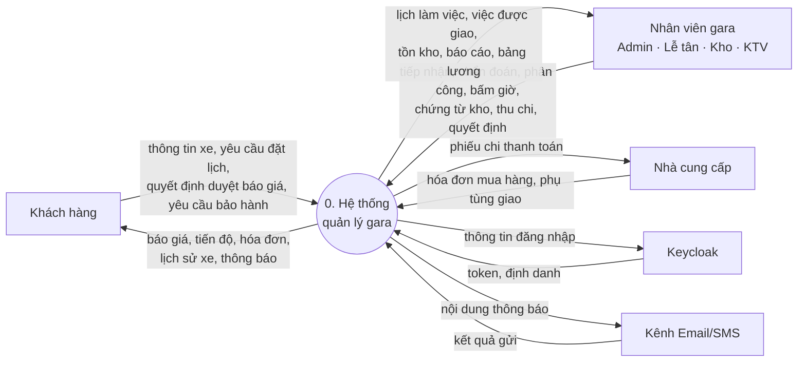
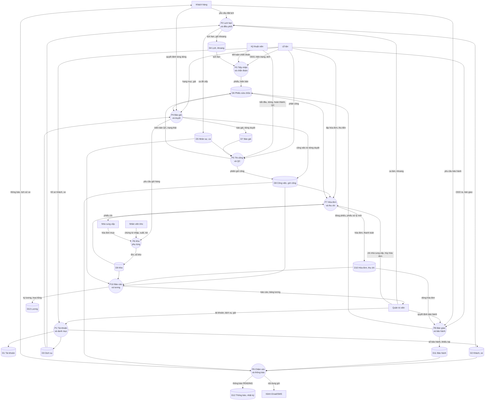
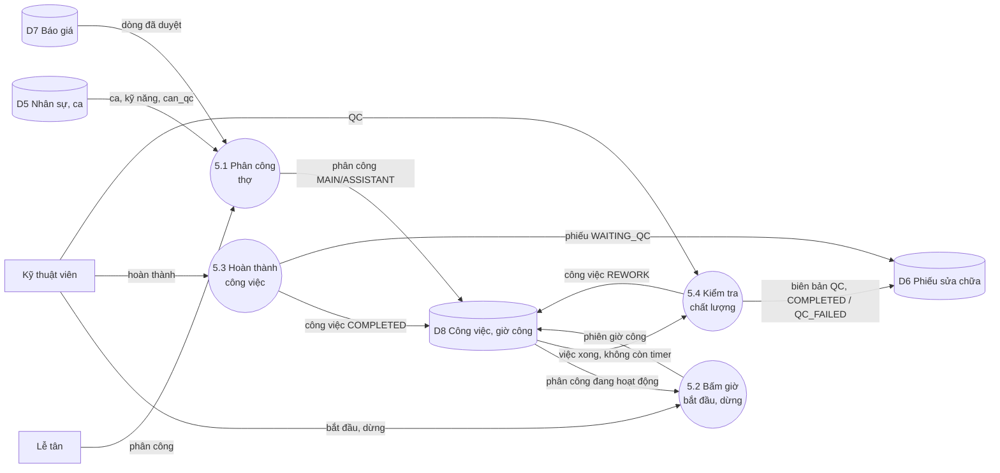
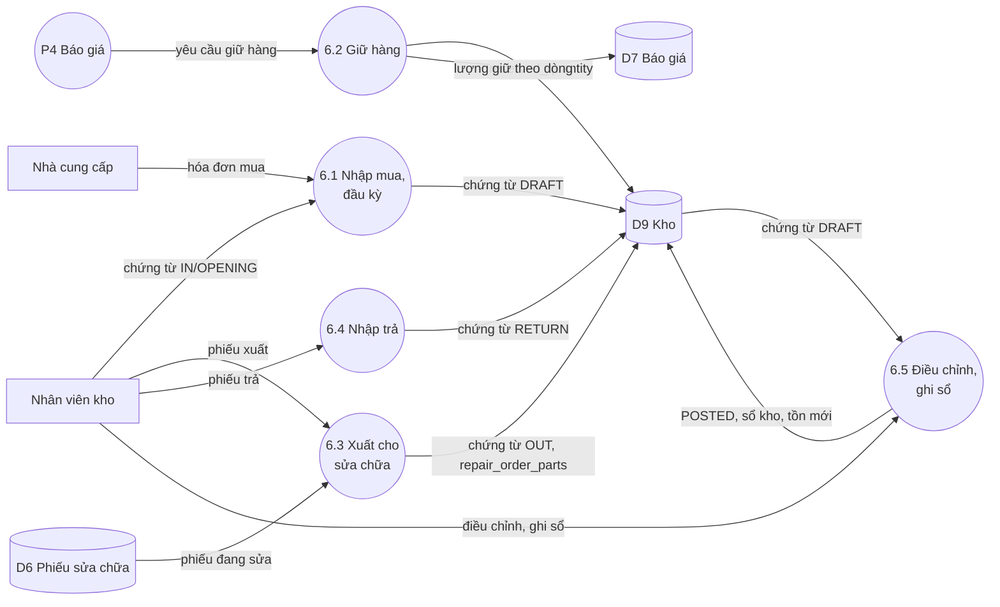
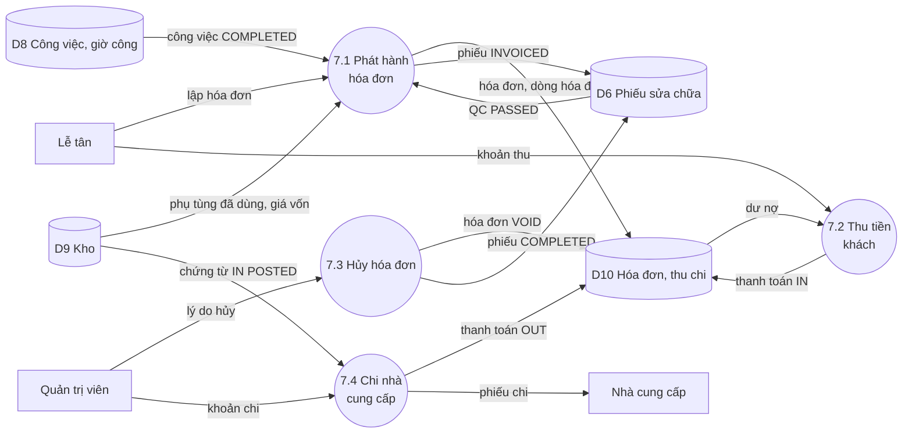

# 3. Sơ đồ luồng dữ liệu (DFD)

> Thuộc plan `system-analysis-erd`. Sơ đồ viết bằng Mermaid nên GitHub và VS Code hiển thị trực tiếp.

**Ký hiệu**

| Hình | Ý nghĩa |
|---|---|
| `((P… tên))` hình tròn | Tiến trình |
| `[(D… tên)]` hình trụ | Kho dữ liệu |
| `[tên]` hình chữ nhật | Tác nhân ngoài |
| Nhãn trên mũi tên | Dữ liệu chảy qua |

## 3.1. Kho dữ liệu ↔ bảng thật (V19)

| Kho | Tên | Bảng |
|---|---|---|
| D1 | Tài khoản | `users` |
| D2 | Khách hàng và xe | `customers`, `vehicles` |
| D3 | Danh mục dịch vụ | `services` |
| D4 | Lịch hẹn và khoang | `bookings`, `service_bays`, `bay_reservations` |
| D5 | Nhân sự và ca | `employees`, `employee_shifts` |
| D6 | Phiếu sửa chữa | `repair_orders`, `vehicle_checks`, `attachments` |
| D7 | Báo giá | `estimates`, `estimate_items` |
| D8 | Công việc và giờ công | `repair_tasks`, `task_assignments`, `labor_sessions`, `repair_order_assignments` |
| D9 | Kho phụ tùng | `suppliers`, `parts`, `repair_order_parts`, `inventory_documents`, `inventory_document_items`, `inventory_transactions` |
| D10 | Hóa đơn và thu chi | `invoices`, `invoice_items`, `payments` (+ view `v_invoice_balances`, `v_supplier_balances`) |
| D11 | Bảo hành | `warranties`, `warranty_claims` |
| D12 | Thông báo và nhật ký | `notifications`, `audit_events` |
| D13 | Lương | `payroll_periods`, `payroll_items`, `order_commissions` |

Cả 34 bảng đều thuộc đúng một kho.

## 3.2. Mức ngữ cảnh

## 3.3. Mức 0

## 3.4. Mức 1 — P5 Thi công và QC

## 3.5. Mức 1 — P6 Kho phụ tùng

## 3.6. Mức 1 — P7 Hóa đơn và thu chi

## 3.7. Kiểm tra cân bằng mức 0 ↔ mức 1

| Tiến trình | Luồng mức 0 | Có trong mức 1 | Kết quả |
|---|---|---|---|
| P5 | Vào: Lễ tân (phân công), KTV (bắt đầu/dừng/hoàn thành/QC), D5, D7 | 5.1 nhận Lễ tân, D5, D7; 5.2–5.4 nhận KTV | Cân bằng |
| P5 | Ra: D8 (phiên giờ công), D6 (biên bản QC, trạng thái) | 5.1–5.4 ghi D8; 5.3, 5.4 ghi D6 | Cân bằng |
| P6 | Vào: Kho (chứng từ), NCC (hóa đơn mua), P4 (yêu cầu giữ hàng) | 6.1 nhận NCC và Kho; 6.2 nhận P4; 6.3–6.5 nhận Kho | Cân bằng; 6.3 đọc thêm D6 để kiểm tra phiếu (chi tiết hóa luồng đọc) |
| P6 | Ra: D9 (tồn, sổ kho) | 6.1–6.5 ghi D9; 6.2 ghi thêm D7 (lượng giữ theo dòng) | Cân bằng; D7 là chi tiết hóa của "yêu cầu giữ hàng" |
| P7 | Vào: Lễ tân, Admin, D6, D8, D9 | 7.1, 7.2 nhận Lễ tân; 7.3, 7.4 nhận Admin; 7.1 đọc D6, D8, D9 | Cân bằng |
| P7 | Ra: D10, NCC (phiếu chi) | 7.1–7.4 ghi D10; 7.4 gửi NCC; 7.1, 7.3 ghi thêm trạng thái phiếu D6 | Cân bằng; ghi D6 là cập nhật trạng thái phiếu, mức 0 gộp trong luồng "hóa đơn" |

**Không có tiến trình "hố đen"** (chỉ nhận vào mà không xuất ra) **hay "phép màu"** (xuất ra mà không có đầu vào). Ở mức 0, mỗi tiến trình đều có ít nhất một luồng vào và một luồng ra.
